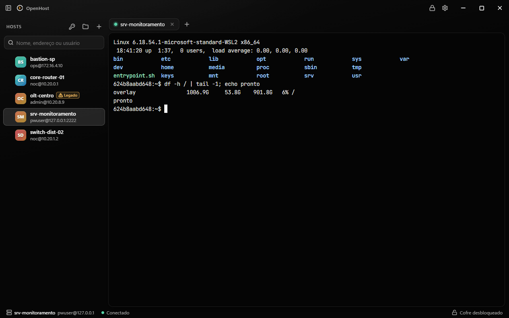
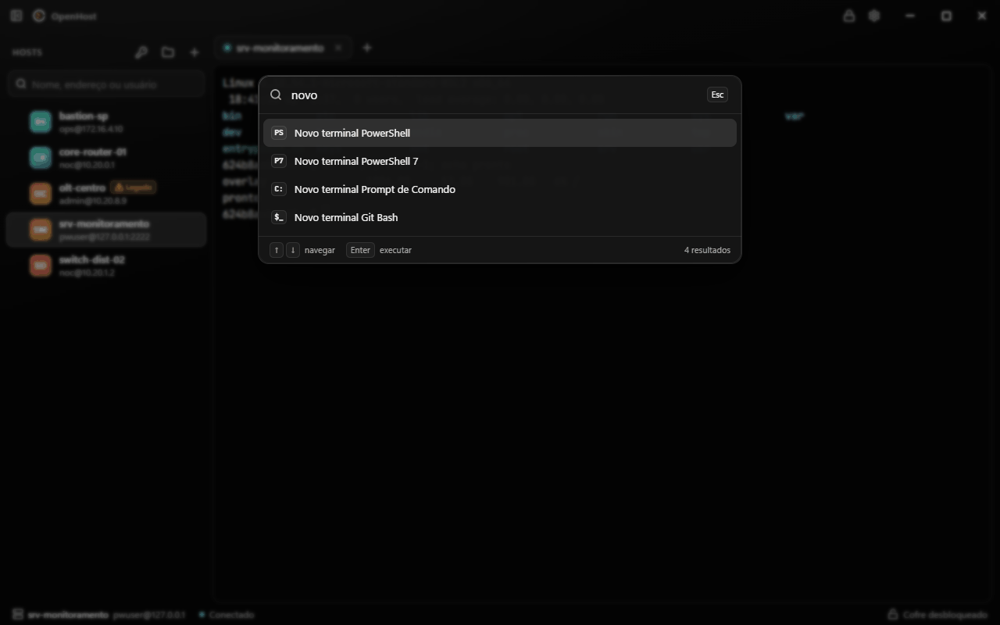
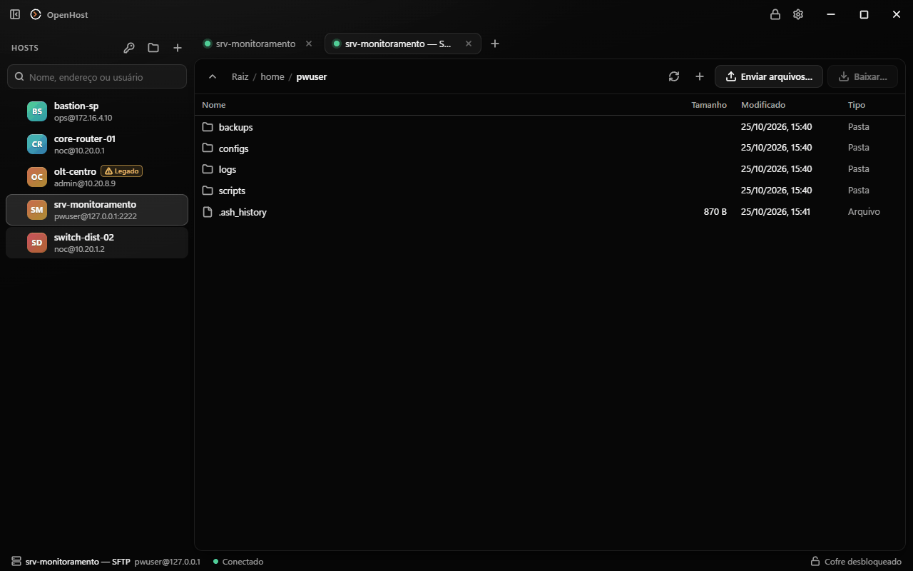
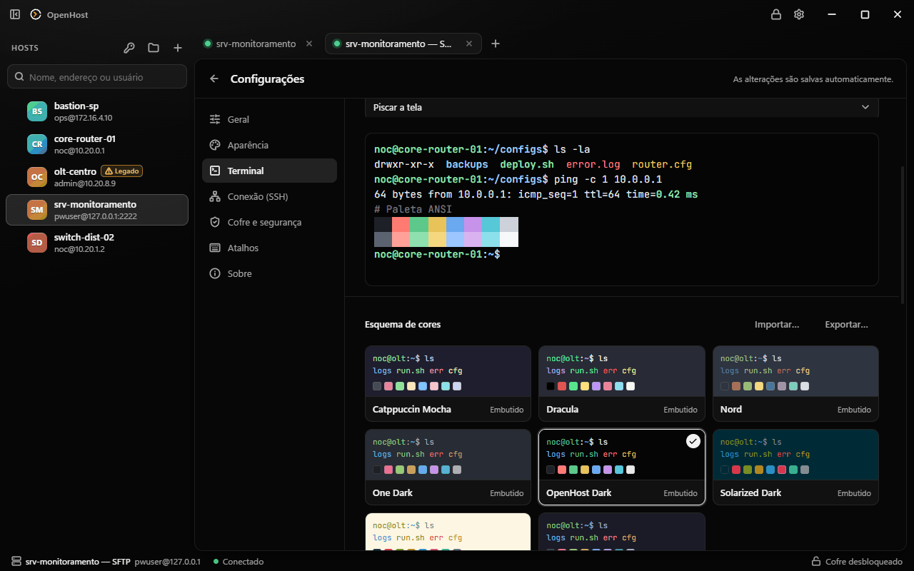
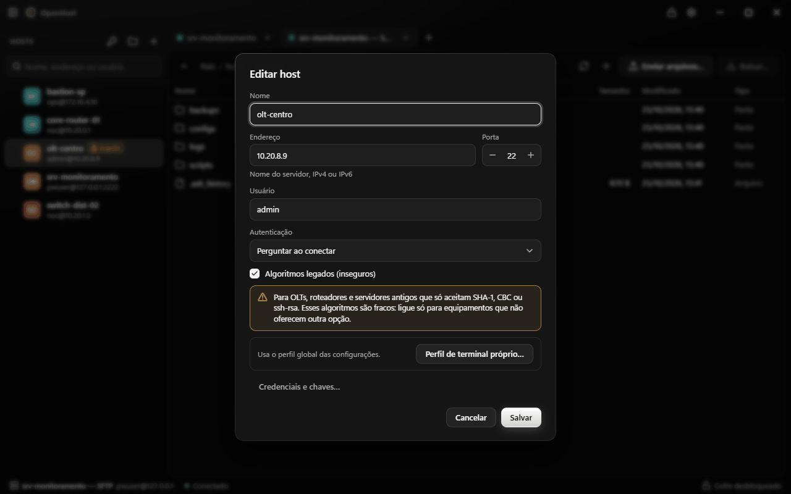
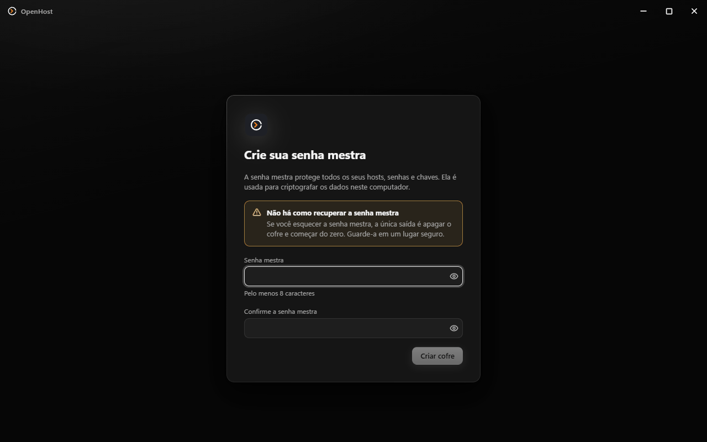

# OpenTerminal

## 📖 Sobre o Projeto

O OpenTerminal é um programa pensado para centralizar seus acessos remotos (SSH e Telnet) de forma
organizada e sincronizada entre Windows, Linux e Android.

Baseado no OpenHost de Emerson Ricardo, o OpenTerminal nasce da necessidade de ter um gerenciador de
conexões simples, multiplataforma e que mantenha seus hosts sempre sincronizados — sem depender de
ferramentas pesadas ou pagas.

## ✨ Funcionalidades

- 🔐 Gerenciamento centralizado de conexões SSH e Telnet
- 🔄 Sincronização entre dispositivos (Windows, Linux e Android) pelo Google Drive
- 🗂️ Organização por grupos e subgrupos
- 🔎 Busca rápida por nome, endereço ou usuário, com os termos em qualquer ordem
- 🖥️ Interface leve e intuitiva
- 🌍 Multiplataforma — mesmo conjunto de dados em todos os sistemas
- 🔑 Suporte a chaves SSH e credenciais
- 📦 Armazenamento local criptografado (Argon2id + XChaCha20-Poly1305), com opção de sincronização
- 🎨 Realce para equipamentos de rede: portas PON, serial e sinal da ONU, alarmes da OLT
- 📁 SFTP e encaminhamento de portas

**[Baixar a última versão](https://github.com/edsondamacena/OpenTerminal/releases/latest)** —
`.deb` para Linux, `.apk` para Android e instalador para Windows. O botão **Atualizar** em
Configurações → Sobre busca a versão nova aqui e só instala se o arquivo conferir com o `SHA256SUMS`.

## Créditos

O OpenTerminal é um fork do **[OpenHost](https://github.com/EmersonRicard0/Openhost)**, criado por
**Emerson**.
O mérito da base do projeto é dele. As capturas abaixo ainda são da versão original.



| | |
|---|---|
|  |  |
| **Paleta de comandos** (Ctrl+Shift+P): hosts, terminais locais detectados e ações. | **SFTP** com transferências em paralelo, na mesma aba de trabalho. |
|  |  |
| **Personalização ao vivo**: fonte, tamanho e esquemas de cores, com importação de Windows Terminal e iTerm. | **Equipamentos legados**: algoritmos antigos por host, com aviso permanente na lista. |



O cofre é criptografado com a senha mestra (Argon2id + XChaCha20-Poly1305) e nunca sai do
computador.

## Requisitos

- Windows 11, ou Windows 10 com o fallback visual sólido.
- Go 1.26 ou superior. O módulo declara Go 1.26.0.
- Wails CLI 2.17.0:

  ```powershell
  go install github.com/wailsapp/wails/v2/cmd/wails@v2.17.0
  wails doctor
  ```

- Node.js 24 LTS e npm para compilar e testar o frontend.
- Microsoft Edge WebView2 Runtime, já incluído nas instalações atuais do Windows 11.
- NSIS para gerar o instalador Windows com `wails build -nsis`.
- Docker Desktop para executar os servidores SSH usados nos testes de integração e E2E.
- OpenSSH Client e `ssh-agent` do Windows para validar autenticação por agente.

Instale as dependências das ferramentas de teste e do frontend depois de obter o repositório:

```powershell
npm ci
npm --prefix frontend ci
```

## Desenvolvimento

Na raiz do repositório, inicie o aplicativo com recarga automática do frontend:

```powershell
wails dev
```

O Wails usa `frontend/` como projeto web e executa os scripts definidos no
[`wails.json`](wails.json).

## Build

O build otimizado e o instalador NSIS são gerados em `build/bin/`:

```powershell
wails build -clean -nsis -trimpath -ldflags "-s -w"
```

O executável mantém o nome interno `openterminal.exe`; o produto instalado é apresentado como
OpenTerminal.

## Publicar uma versão

O workflow de release é disparado por tags no formato `vX.Y.Z`. Antes de publicar, mantenha o
número em `wails.json` alinhado com a tag e confirme que `node scripts/check.mjs` está verde.

Crie e envie a tag a partir do commit que será publicado:

```powershell
git tag v0.3.0
git push origin v0.3.0
```

O GitHub Actions instala Go, Node.js, Wails e NSIS, gera o instalador, executa a verificação de
release e anexa `OpenTerminal-amd64-installer.exe` ao release da tag. Tags `v0.*` e tags com sufixo,
como `v1.0.0-rc.1`, são publicadas como pré-release.

## Testes

Testes Go:

```powershell
go test ./...
```

Testes unitários do frontend:

```powershell
npm --prefix frontend run test
```

O portão de qualidade completo também executa `go vet`, testes Go, verificação de tokens,
lint, verificação de tipos e testes do frontend:

```powershell
node scripts/check.mjs
```

Para os testes de integração, inicie primeiro as fixtures Docker e depois execute os pacotes
Go com a tag `integration`:

```powershell
node scripts/sshd.mjs up
go test -tags integration ./internal/...
```

Ao terminar, os contêineres podem ser removidos com:

```powershell
node scripts/sshd.mjs down
```

Os testes E2E são executados a partir de `frontend/`. O setup do Playwright gera
automaticamente um build Wails com a tag `e2e`:

```powershell
Set-Location frontend
npx playwright test
```

Quando `build/bin/openterminal-e2e.exe` já tiver sido gerado e não precisar ser recompilado,
use `OPENTERMINAL_E2E_SKIP_BUILD=1`:

```powershell
$env:OPENTERMINAL_E2E_SKIP_BUILD = "1"
npx playwright test
Remove-Item Env:OPENTERMINAL_E2E_SKIP_BUILD
```

## Migração do cofre anterior

A versão Wails reconhece automaticamente o cofre da versão 001 no diretório:

```text
%APPDATA%\OpenTerminal
```

Quando `vault.svlt` existe e ainda não há `openterminal.db`, a tela de desbloqueio informa que
encontrou um cofre anterior. Ao digitar a senha mestra correta, o aplicativo migra numa única
transação:

- grupos e sua hierarquia;
- hosts e ordem de exibição;
- credenciais de senha e chave;
- chaves de servidores já conhecidas;
- regras de encaminhamento;
- configurações do cofre e preferências da interface.

Depois de gravar e conferir o novo `openterminal.db`, o arquivo original é preservado como
`vault.svlt.migrated`. Se a senha estiver errada ou a migração falhar, o arquivo original não é
alterado e a operação pode ser tentada novamente.

Mais detalhes de validação estão em
[`specs/002-wails-migration/quickstart.md`](specs/002-wails-migration/quickstart.md).
